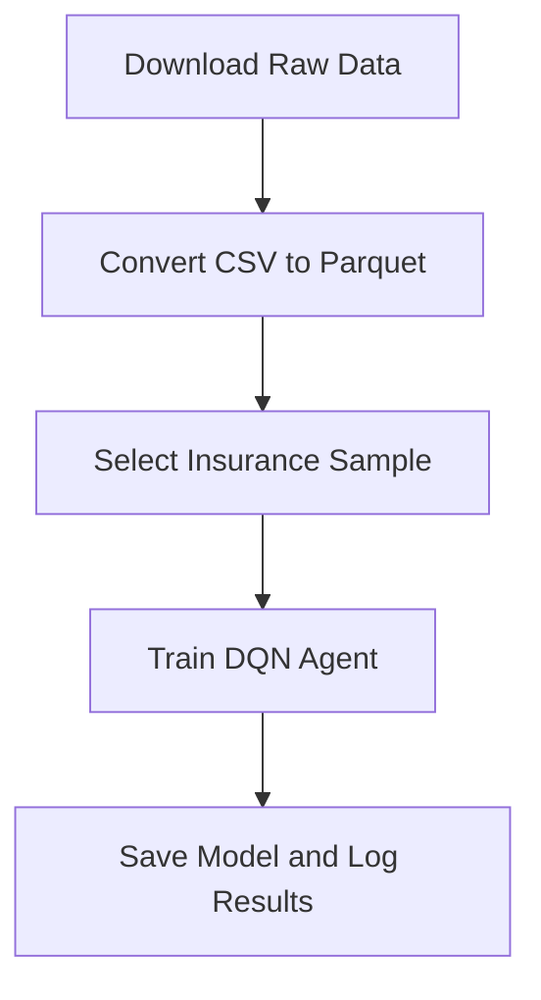
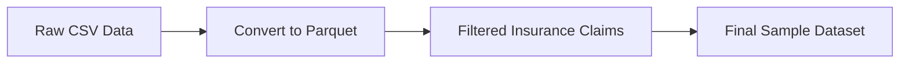
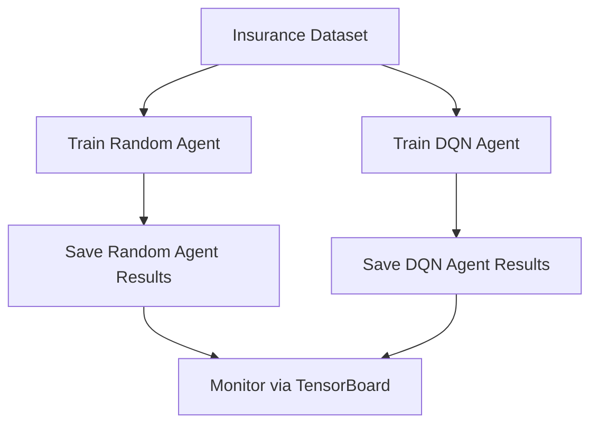

# InsurEnv - A Fraud Detection Reinforcement Learning Environment


## Overview

**InsurEnv** is a reinforcement learning environment designed to tackle fraud detection in the insurance industry. Using Deep Q-Networks (DQN), this project leverages a dataset of insurance claims to train an agent that identifies potentially fraudulent cases under a predefined budget constraint.

This pipeline involves:
1. Downloading raw data and preparing it for analysis.
2. Converting data from CSV to Parquet format for efficient processing.
3. Selecting relevant data for training based on insurance claims exceeding a set value.
4. Training a DQN agent to maximize rewards by identifying fraudulent claims within a budget.
5. Logging training progress in TensorBoard and saving experiment results.

## Installation

### Prerequisites

- **Python 3.8+**
- **Conda package manager**

### Environment Setup

First, create and activate the Conda environment:

```bash
conda create --name gym_insurance python=3.8
conda activate gym_insurance
```

Next, install all necessary dependencies:

```bash
pip install -r requirements.txt
```

Alternatively, use `environment.yml` to install packages:

```bash
conda env create -f environment.yml
conda activate gym_insurance
```

---

## Project Workflow

To run the full pipeline, follow these steps in order.

### 1. Download Data

The first step is to download all input data from official sources. Run the following command:

```bash
python .scripts/download_data.py
```

This script will download and save the raw data into `.temp/data/raw`.

### 2. Convert CSV to Parquet

Once the raw data is available, convert it to Parquet format for optimized data processing:

```bash
python .scripts/convert_csv_to_parquet.py
```

The data will be processed and saved as Parquet files in `.temp/data/processed/`.

### 3. Select Insurance Sample Data

The next step is to filter and prepare the data specifically related to insurance claims exceeding a value threshold (e.g., claims higher than 10,000):

```bash
python .scripts/select_pr_soybean_sample.py
```

This script processes and saves the selected data sample in `.temp/data/processed/sample_data/`.

### 4. Train DQN Agent

Finally, run the script to train the DQN agent on the selected insurance data. The agent will learn to maximize rewards while adhering to a predefined budget constraint:

```bash
python .scripts/produce_article_results.py
```

This will initiate the training process, logging the agent’s performance and saving model checkpoints in `.temp/experiment_results/`.

---

## Monitoring the Training Process

During the training phase, you can monitor the agent’s progress using TensorBoard. The logs will be stored in `.temp/tensorboard_logs/`. To start TensorBoard, run:

```bash
tensorboard --logdir .temp/tensorboard_logs/
```

You can observe metrics such as rewards, losses, and epsilon decay across episodes in real-time.

---

## Pipeline Flow Diagrams

### 1. General Data Flow



### 2. Data Transformation Overview



### 3. DQN Agent Training Flow



---

## Folder Structure

```plaintext
.project_root/
│
├── .scripts/
│   ├── download_data.py
│   ├── convert_csv_to_parquet.py
│   ├── select_pr_soybean_sample.py
│   └── produce_article_results.py
│
├── .temp/
│   ├── data/
│   │   ├── raw/
│   │   ├── processed/
│   │   └── sample_data/
│   ├── experiment_results/
│   └── tensorboard_logs/
│
├── environment.yml
├── requirements.txt
├── README.md
└── LICENSE
```

---

## Results and Checkpoints

- The results of the DQN and random agents, including model weights and performance metrics, are stored in `.temp/experiment_results/`.
- Training logs and scalar metrics such as reward and loss for each episode are saved in `.temp/tensorboard_logs/` for TensorBoard monitoring.

---

## License

This project is licensed under the MIT License. See the `LICENSE` file for more details.

---

## Contributing

We welcome contributions! If you'd like to contribute to this project, please submit a pull request or open an issue for discussion.

---

## Contact

For questions or support regarding the project, please contact the maintainers.

